# Second Brain — полная архитектура

> Статус: целевая архитектура (draft)  
> Дата: 2026-11-03  
> Область: центральная память для OpenCode и Jarvis  
> Деплой: Dokploy + Let's Encrypt, S3-совместимое хранилище для бэкапов  
> Roadmap: [ROADMAP.md](ROADMAP.md)

---

## 1. Краткое резюме

Second Brain — это центральная база знаний, которая живёт на удалённом сервере.

- **Сервер на Go** владеет SQLite, полнотекстовым поиском FTS5, генерацией карточек, очередью и MCP.
- **Локальное приложение на SwiftUI** — единственный исполняемый файл на macOS. Оно показывает UI, следит за локальной папкой `spool/` и отправляет данные на сервер.
- **Плагин OpenCode** — тонкий TypeScript-адаптер. Он не является отдельным процессом и не ходит в сеть: только собирает нормализованные сессии и складывает JSON-бандлы в `spool/`.
- **Jarvis** живёт на сервере и пишет в память через MCP `remember` или HTTP `/api/v1/memories`.
- **Поиск и карточки** выполняются только на сервере.
- **Бэкапы** — полные снимки SQLite каждые 6 часов в S3-бакет `meme`, хранится 20 последних. Без UI, без API, восстановление только через CLI на сервере.

Ключевой принцип: **никто не пишет в SQLite напрямую**. Все записи проходят через ingestion API и очередь, единственный writer — процесс `brain`.

---

## 2. Ограничения и принятые решения

| Решение | Значение |
|---|---|
| Источники | Только OpenCode и Jarvis |
| Локальная часть | Одно `.app`-приложение на SwiftUI, без Docker и без фонового демона |
| Сервер | Go, один контейнер в Dokploy |
| База | SQLite + FTS5, один writer |
| Поиск | BM25 + поправка на свежесть, только на сервере |
| Карточки | Генерируются на сервере, дешёвая LLM |
| MCP | Streamable HTTP, bearer-токены |
| Домен | Dokploy/Traefik + Let's Encrypt |
| Бэкапы | Полный `VACUUM INTO`, каждые 6 часов, S3 bucket `meme`, 20 копий |
| Шифрование бэкапов | Нет (решение пользователя) |
| Backup UI/API | Нет |
| Восстановление | Только CLI на сервере |
| Версионирование S3 | Предполагается выключенным |

---

# 3. C4 Level 1 — System Context

> Диаграммы ниже — Mermaid **flowchart** с сохранением уровней C4. Стандартный C4-рендер в тёмных темах накладывает подписи и плохо читается; flowchart даёт предсказуемую раскладку. Текстовые таблицы и ASCII-схемы продублированы под каждой диаграммой.

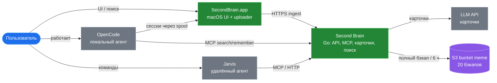

```text
Пользователь
   ├── OpenCode ── plugin ──► spool ──► SecondBrain.app ──► brain
   │        └──────────────── MCP ───────────────────────► brain
   ├── Jarvis ──────────────── MCP/HTTP ─────────────────► brain
   └── SecondBrain.app ─────── REST ─────────────────────► brain

brain ──► SQLite / FTS5
brain ──► LLM API      (карточки)
brain ──► S3 bucket meme (20 полных бэкапов, каждые 6 часов)
```

### Участники

| Участник | Тип | Роль |
|---|---|---|
| Пользователь | Person | Работает в OpenCode, общается с Jarvis, пользуется macOS-приложением |
| OpenCode | External system | Источник сессий и MCP-клиент |
| Jarvis | External system | Удалённый агент, пишет память по команде |
| Second Brain | System | Центральная память |
| S3 / MinIO | External system | Хранилище бэкапов |
| LLM Provider | External system | Генерация карточек |

### Основные сценарии

1. OpenCode завершает сессию → плагин пишет бандл в spool → приложение отправляет на сервер → сервер строит карточку и индексирует.
2. Пользователь ищет по памяти в приложении → приложение вызывает REST `/api/v1/search` → сервер отвечает карточками.
3. Агент вызывает MCP `search` или `remember` → сервер ищет или сохраняет.
4. Jarvis по команде пользователя вызывает `remember` → запись появляется в общей памяти.
5. Каждые 6 часов сервер делает полный снимок SQLite и загружает в S3.

---

# 4. C4 Level 2 — Containers

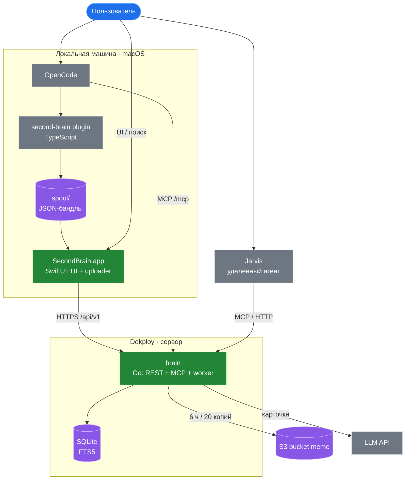

```text
macOS
  OpenCode ──► plugin ──► spool/ ──► SecondBrain.app
                                         │
                                         │ HTTPS /api/v1
                                         ▼
Dokploy                          ┌──────────────────────┐
                                 │ brain (Go)           │
                                 │  REST + MCP + worker │
                                 │  SQLite + FTS5       │
                                 └──────────┬───────────┘
                                            │ S3 API
                                            ▼
                                   bucket meme (20 бэкапов)
```

## 4.1 Контейнеры

| Контейнер | Технология | Ответственность |
|---|---|---|
| `SecondBrain.app` | SwiftUI, macOS | UI, onboarding, установка плагина, наблюдение за spool, очередь отправки, токены в Keychain |
| `brain` | Go | REST, MCP, приём, очередь, маскировка, карточки, поиск, финализация, бэкапы |
| `SQLite brain.db` | SQLite + FTS5 | Единственное хранилище знаний и очереди |
| `Spool` | Файловая система | Локальная очередь JSON-бандлов между OpenCode и приложением |
| `OpenCode plugin` | TypeScript | Сбор сессий OpenCode и запись бандлов в spool |

## 4.2 Границы доверия

```text
┌──────────────────────────────┐
│ Локальная машина             │
│  OpenCode + plugin           │
│  SecondBrain.app             │
│  spool/                      │
│  Keychain, токены 0600       │
└──────────────┬───────────────┘
               │ HTTPS + bearer
┌──────────────▼───────────────┐
│ Сервер Dokploy               │
│  Traefik + Let's Encrypt     │
│  brain (единственный writer) │
│  SQLite volume               │
└──────────────┬───────────────┘
               │ S3 API + TLS
┌──────────────▼───────────────┐
│ Другой сервер                │
│  S3/MinIO bucket meme        │
│  20 полных бэкапов           │
└──────────────────────────────┘
```

- Локальные сессии и токены не покидают машину, кроме загрузки на сервер.
- Сервер не имеет доступа к локальным файлам, кроме полученных бандлов.
- S3 не имеет доступа к серверу; только сервер пишет в бакет.
- Прямого доступа к SQLite по сети нет.

---

# 5. C4 Level 3 — Components

## 5.1 Сервер `brain` (Go)

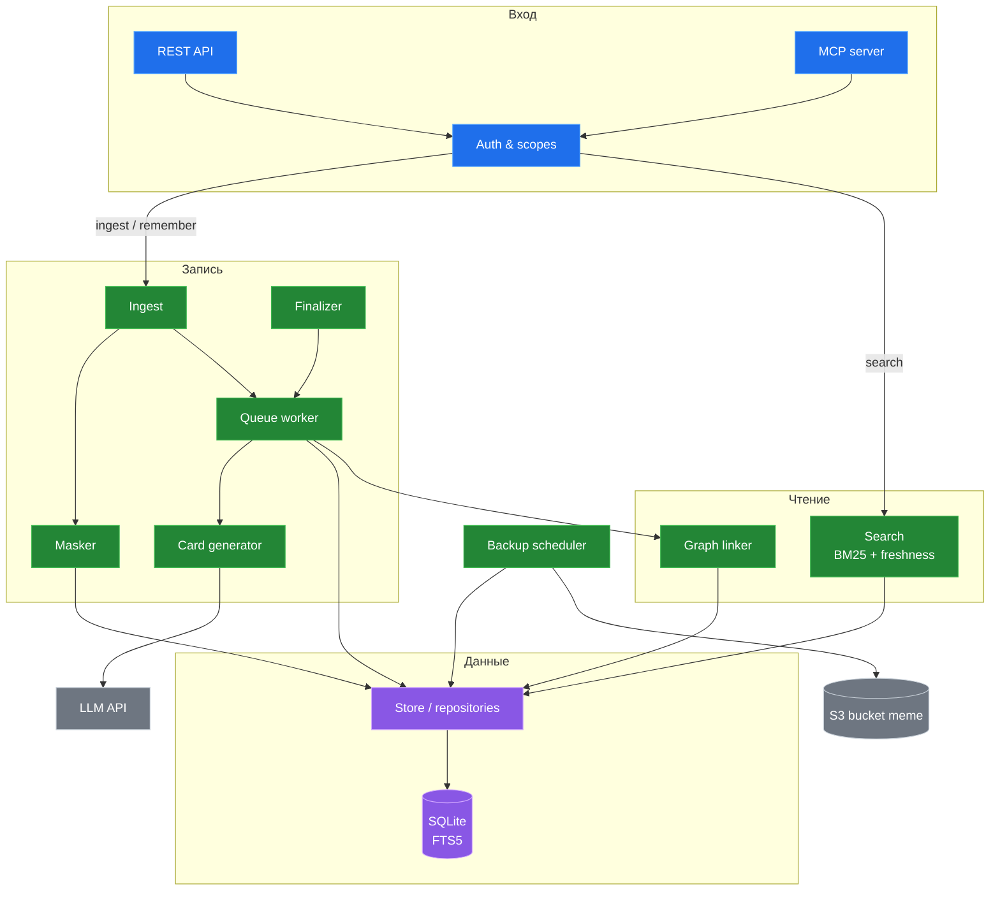

### Компоненты сервера

| Компонент | Ответственность |
|---|---|
| REST API | Публичный HTTP API для приложения и Jarvis |
| MCP Server | MCP-инструменты для OpenCode и Jarvis |
| Auth & Scopes | Проверка bearer-токена, определение клиента и source |
| Ingest Service | Приём сессий и memories, идемпотентность, запись в БД |
| Job Worker | Асинхронная обработка очереди, retry, финализация |
| Secret Masker | Удаление ключей, токенов, паролей до LLM и до записи |
| Card Generator | Генерация title/summary/questions/keywords/atoms |
| Search Service | FTS5 MATCH, BM25, префиксы, freshness, top-N |
| Graph Linker | Связи между записями и проектами |
| Finalizer | Завершение сессий по idle-таймауту |
| Backup Scheduler | Полные снимки SQLite в S3 и ротация |
| Store | SQL, миграции, репозитории |

## 5.2 Локальное приложение `SecondBrain.app`

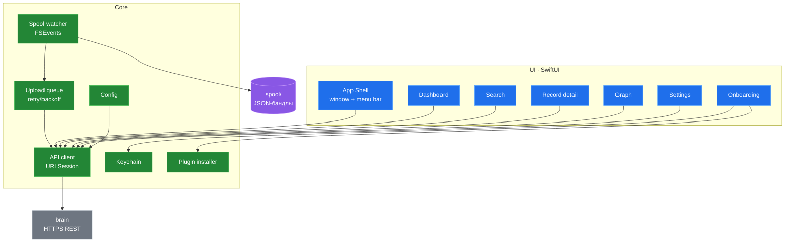

### Компоненты приложения

| Компонент | Ответственность |
|---|---|
| App Shell | Главное окно, menu bar, навигация |
| Onboarding | Подключение к серверу, создание токенов, установка плагина |
| Dashboard | Сводка: записи, очередь, клиенты, ошибки |
| Search | Запрос к серверу и отображение результатов |
| Record Detail | Карточка и `raw_text` |
| Graph | Визуализация связей |
| Projects | Список проектов |
| Settings | URL, токены, launch at login |
| API Client | HTTP-клиент к `brain` |
| Spool Watcher | Наблюдение за `spool/` |
| Upload Queue | Отправка бандлов с retry/backoff |
| Keychain | Хранение admin/ui токенов |
| Config | Локальная конфигурация |
| Plugin Installer | Копирование плагина и правка OpenCode config |

## 5.3 Плагин OpenCode

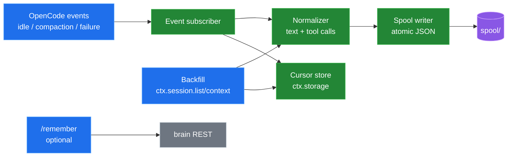

### Компоненты плагина

| Компонент | Ответственность |
|---|---|
| Event Subscriber | Подписка на события OpenCode |
| Backfill | Импорт существующих сессий при первом запуске |
| Normalizer | Приведение сообщений к общему формату |
| Cursor Store | Курсоры и защита от повторной отправки |
| Spool Writer | Атомарная запись бандлов в `spool/` |
| Remember Command | Опциональная команда для явного сохранения |

---

# 6. C4 Level 4 — Code / Modules

C4 Level 4 редко рисуют полностью, поэтому ниже — структура модулей и ключевые контракты.

## 6.1 Go-сервер

> Целевая структура; пакеты добавляются по мере вех. На M1 реализованы `config`,
> `httpapi`, `auth` и `store`.

```text
server/
  cmd/brain/
    main.go                # serve, healthcheck, later backup/restore
  internal/
    config/                # env + config
    httpapi/               # REST handlers, middleware
    mcp/                   # MCP tools
    auth/                  # tokens, scopes, clients
    ingest/                # validation, idempotency, source resolution
    queue/                 # job worker, retries, finalization
    card/                  # prompt, LLM client, JSON validation, heuristic
    mask/                  # secret masking
    search/                # FTS query builder, BM25, freshness
    store/                 # SQLite, migrations, repositories, FTS triggers
    graph/                 # links
    finalizer/             # idle sessions -> final
    backup/                # VACUUM INTO, S3, rotation, restore
    obs/                   # logging, health, metrics
  Dockerfile
```

## 6.2 SwiftUI-приложение

```text
app/
  SecondBrain/
    App/
      SecondBrainApp.swift
      AppState.swift
      MenuBar.swift
    Features/
      Onboarding/
      Dashboard/
      Search/
      Records/
      Graph/
      Projects/
      Agents/
      Settings/
    Core/
      APIClient.swift
      KeychainStore.swift
      SpoolWatcher.swift
      UploadQueue.swift
      ConfigStore.swift
      PluginInstaller.swift
      Models.swift
```

## 6.3 OpenCode plugin

```text
plugin/second-brain/
  index.ts        # Plugin.define, setup, event subscription
  capture.ts      # сбор сессии
  normalize.ts    # нормализация сообщений
  spool.ts        # атомарная запись
  cursor.ts       # ctx.storage
  config.ts       # чтение ~/.config/second-brain/config.json
```

## 6.4 Ключевые контракты

### Spool bundle

```json
{
  "bundle_id": "uuid",
  "source": "opencode",
  "external_id": "ses_...",
  "project_key": "opencode:project_...",
  "project_path": "/Users/serg/PhpstormProjects/meme",
  "title": "Название сессии",
  "final": true,
  "started_at": "2026-11-03T12:00:00Z",
  "updated_at": "2026-11-03T13:00:00Z",
  "messages": [
    { "id": "msg_1", "role": "user", "text": "...", "at": "..." },
    { "id": "msg_2", "role": "assistant", "text": "...", "at": "..." }
  ],
  "metadata": {
    "agent": "build",
    "model": "provider/model",
    "branch": "main",
    "opencode_version": "..."
  }
}
```

### Ingest request

`POST /api/v1/ingest`

```json
{
  "bundle_id": "uuid",
  "external_id": "ses_...",
  "project_key": "opencode:project_...",
  "project_path": "/Users/serg/...",
  "title": "...",
  "final": true,
  "started_at": "...",
  "updated_at": "...",
  "messages": [],
  "metadata": {}
}
```

Ответ:

```json
{
  "record_id": 42,
  "job_id": 17,
  "status": "queued"
}
```

### Memory request

`POST /api/v1/memories`

```json
{
  "external_id": "evt_...",
  "project_key": "jarvis",
  "occurred_at": "...",
  "title": "...",
  "summary": "...",
  "keywords": ["..."],
  "atoms": ["..."],
  "raw_text": "..."
}
```

Если карточка уже заполнена, LLM не вызывается.

### MCP `remember`

```json
{
  "text": "Решение: используем SQLite FTS5 вместо pgvector",
  "project": "second-brain",
  "tags": ["decision", "sqlite"],
  "title": "Опционально"
}
```

`source` определяется по токену, а не по телу запроса.

---

# 7. Runtime scenarios

## 7.1 Захват сессии OpenCode

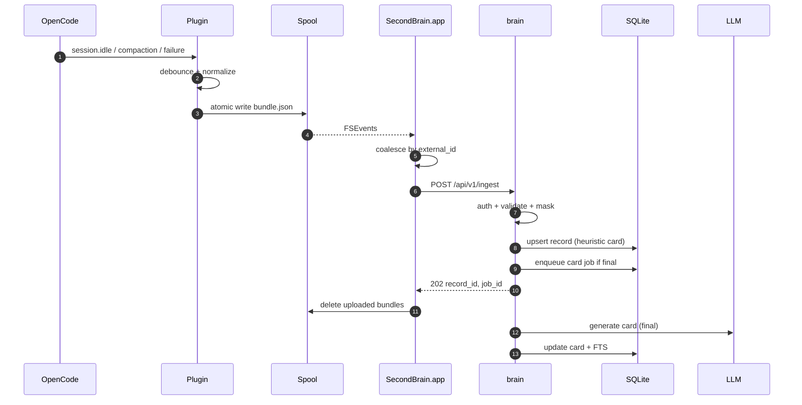

## 7.2 Backfill истории

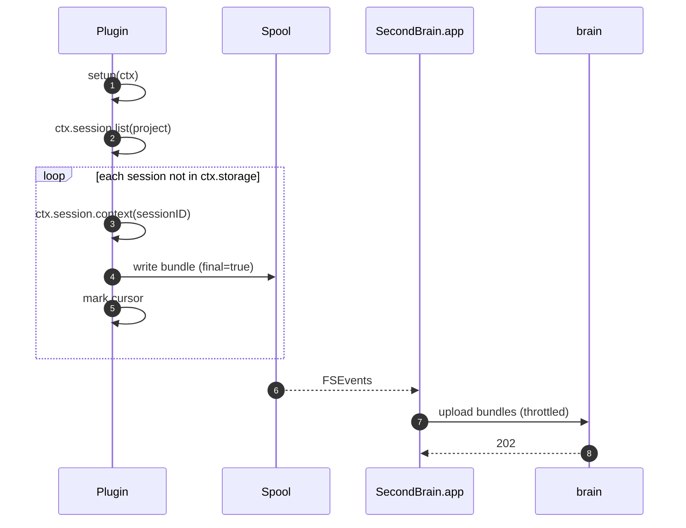

## 7.3 Jarvis `remember`

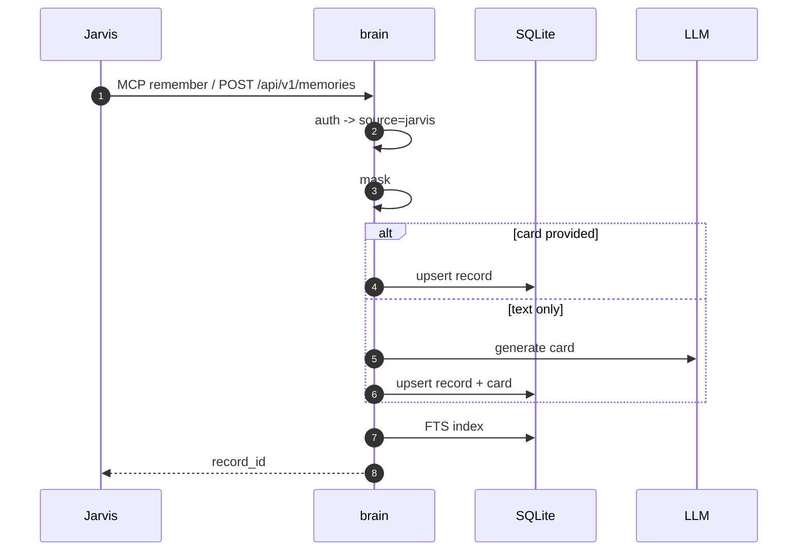

## 7.4 Поиск

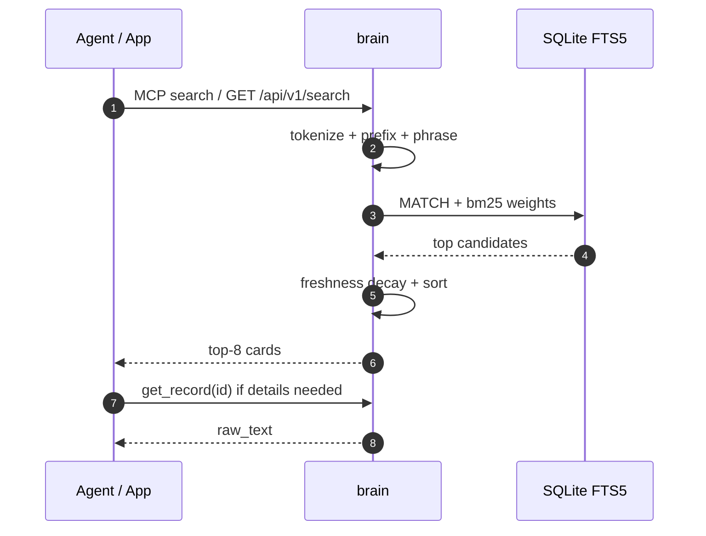

## 7.5 Финализация сессии

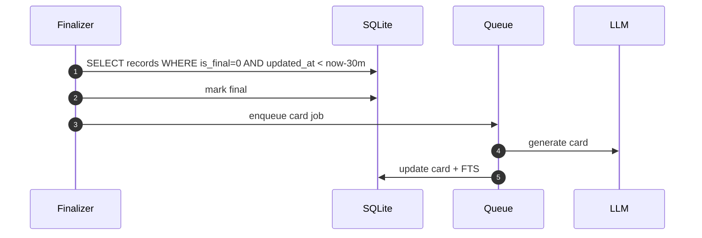

## 7.6 Бэкап

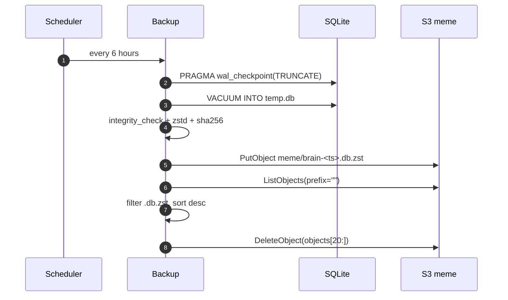

## 7.7 Восстановление

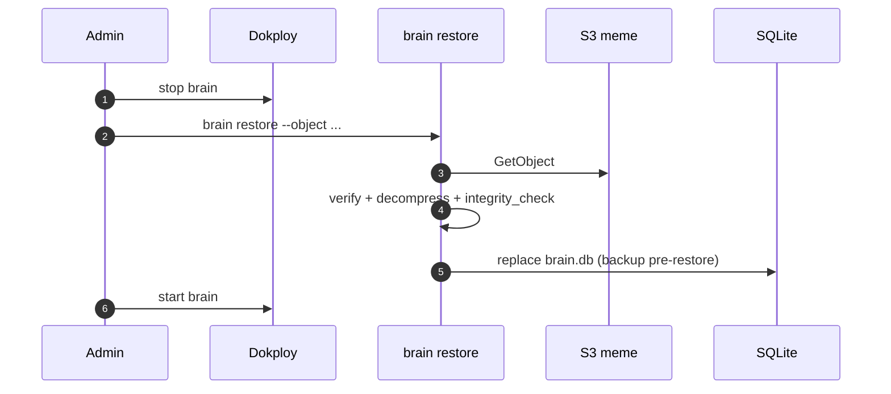

---

# 8. Данные

## 8.1 Схема SQLite

```sql
PRAGMA journal_mode = WAL;
PRAGMA synchronous = NORMAL;
PRAGMA foreign_keys = ON;
PRAGMA busy_timeout = 5000;

CREATE TABLE clients (
    id            INTEGER PRIMARY KEY,
    name          TEXT NOT NULL,          -- unique among non-revoked clients
    kind          TEXT NOT NULL CHECK (kind IN ('opencode', 'jarvis', 'ui', 'admin')),
    token_hash    TEXT NOT NULL UNIQUE,
    scopes        TEXT NOT NULL,          -- ingest,mcp:read,mcp:write,admin,ui
    created_at    TEXT NOT NULL,
    last_seen_at  TEXT,
    revoked_at    TEXT
);

CREATE UNIQUE INDEX clients_active_name ON clients(name) WHERE revoked_at IS NULL;

CREATE TABLE projects (
    id          INTEGER PRIMARY KEY,
    key         TEXT NOT NULL UNIQUE,     -- opencode:<projectID> | jarvis | git remote
    name        TEXT NOT NULL,
    path        TEXT NOT NULL DEFAULT '',
    created_at  TEXT NOT NULL
);

CREATE TABLE records (
    id              INTEGER PRIMARY KEY,
    client_id       INTEGER NOT NULL REFERENCES clients(id),
    source          TEXT NOT NULL,        -- opencode | jarvis
    external_id     TEXT NOT NULL,        -- session_id / event_id
    project_id      INTEGER REFERENCES projects(id),
    kind            TEXT NOT NULL DEFAULT 'session', -- session | memory
    title           TEXT NOT NULL,
    summary         TEXT NOT NULL DEFAULT '',
    questions       TEXT NOT NULL DEFAULT '', -- newline-separated
    keywords        TEXT NOT NULL DEFAULT '', -- newline-separated
    atoms           TEXT NOT NULL DEFAULT '', -- newline-separated
    raw_text        TEXT NOT NULL,
    content_hash    TEXT NOT NULL,
    revision        INTEGER NOT NULL DEFAULT 1,
    is_final        INTEGER NOT NULL DEFAULT 0,
    finalized_at    TEXT,
    started_at      TEXT,
    updated_at      TEXT NOT NULL,
    indexed_at      TEXT NOT NULL,
    card_model      TEXT,
    card_status     TEXT NOT NULL DEFAULT 'heuristic', -- heuristic|queued|ok|failed
    metadata_json   TEXT NOT NULL DEFAULT '{}',
    UNIQUE(client_id, source, external_id)
);

CREATE INDEX idx_records_project ON records(project_id);
CREATE INDEX idx_records_updated ON records(updated_at DESC);
CREATE INDEX idx_records_final   ON records(is_final, updated_at);

CREATE VIRTUAL TABLE records_fts USING fts5(
    title,
    summary,
    questions,
    keywords,
    atoms,
    raw_text,
    content='records',
    content_rowid='id',
    tokenize='unicode61 remove_diacritics 2'
);

CREATE TRIGGER records_ai AFTER INSERT ON records BEGIN
    INSERT INTO records_fts(rowid, title, summary, questions, keywords, atoms, raw_text)
    VALUES (new.id, new.title, new.summary, new.questions, new.keywords, new.atoms, new.raw_text);
END;

CREATE TRIGGER records_ad AFTER DELETE ON records BEGIN
    INSERT INTO records_fts(records_fts, rowid, title, summary, questions, keywords, atoms, raw_text)
    VALUES ('delete', old.id, old.title, old.summary, old.questions, old.keywords, old.atoms, old.raw_text);
END;

CREATE TRIGGER records_au AFTER UPDATE ON records BEGIN
    INSERT INTO records_fts(records_fts, rowid, title, summary, questions, keywords, atoms, raw_text)
    VALUES ('delete', old.id, old.title, old.summary, old.questions, old.keywords, old.atoms, old.raw_text);

    INSERT INTO records_fts(rowid, title, summary, questions, keywords, atoms, raw_text)
    VALUES (new.id, new.title, new.summary, new.questions, new.keywords, new.atoms, new.raw_text);
END;

CREATE TABLE ingest_jobs (
    id               INTEGER PRIMARY KEY,
    client_id        INTEGER NOT NULL REFERENCES clients(id),
    idempotency_key  TEXT NOT NULL DEFAULT '', -- request that enqueued the job
    source           TEXT NOT NULL,
    external_id      TEXT NOT NULL,
    record_id        INTEGER REFERENCES records(id),
    kind             TEXT NOT NULL,       -- ingest | memory
    status           TEXT NOT NULL,       -- queued|running|done|failed
    attempts         INTEGER NOT NULL DEFAULT 0,
    next_retry_at    TEXT,
    error            TEXT NOT NULL DEFAULT '',
    created_at       TEXT NOT NULL,
    updated_at       TEXT NOT NULL
);

CREATE INDEX idx_ingest_jobs_status ON ingest_jobs(status, id);

-- Replay state for Idempotency-Key, kept separate from the queue so a natural
-- replay does not create a card job. Rows are valid for 24 hours.
CREATE TABLE idempotency_keys (
    client_id     INTEGER NOT NULL REFERENCES clients(id),
    operation     TEXT NOT NULL,
    key           TEXT NOT NULL,
    request_hash  TEXT NOT NULL,
    record_id     INTEGER NOT NULL REFERENCES records(id),
    job_id        INTEGER REFERENCES ingest_jobs(id),
    status        TEXT NOT NULL CHECK (status IN ('queued', 'stored')),
    created_at    TEXT NOT NULL,
    PRIMARY KEY (client_id, operation, key)
);

CREATE INDEX idx_idempotency_created ON idempotency_keys(created_at);

CREATE TABLE links (
    from_id  INTEGER NOT NULL REFERENCES records(id) ON DELETE CASCADE,
    to_id    INTEGER NOT NULL REFERENCES records(id) ON DELETE CASCADE,
    weight   REAL NOT NULL DEFAULT 1,
    reason   TEXT NOT NULL DEFAULT '',
    PRIMARY KEY (from_id, to_id)
);
```

## 8.2 Карточка

| Поле | Значение |
|---|---|
| `title` | Короткое название, одна строка |
| `summary` | 3–6 предложений: что просили, что сделали, чем закончилось |
| `questions` | 5–10 вопросов, которыми запись будут искать |
| `keywords` | Все словоформы, синонимы, имена файлов, библиотеки |
| `atoms` | Дословные факты, решения, ошибки, команды, флаги |

## 8.3 Поиск

Веса FTS5-колонок:

```text
title      ×6
summary    ×4
questions  ×4
keywords   ×5
atoms      ×3
raw_text   ×1
```

Формула:

```text
score = -bm25(records_fts, 6, 4, 4, 5, 3, 1)
        × 0.5^(age_days / 120)
```

- `bm25()` в SQLite возвращает отрицательные значения, поэтому знак меняется.
- Полураспад свежести — 120 дней.
- Запрос нормализуется: нижний регистр, токенизация, префиксы для русских словоформ, точная фраза.
- По умолчанию возвращается топ-8.
- `search` отдаёт карточки без `raw_text`; `get_record` — полный текст.

## 8.4 Жизненный цикл записи

```text
ingest
  → records (card_status=heuristic)
  → ingest_jobs (queued)
  → worker
  → card_status=ok / failed
  → FTS updated
```

- `final=false`: обновляется `raw_text`, карточка не генерируется.
- `final=true`: карточка ставится в очередь.
- Нет `final` 30 минут: `Finalizer` помечает сессию завершённой и ставит карточку в очередь.
- Повторный ingest с тем же `content_hash` не создаёт дубль.
- `revision` увеличивается при изменении записи.

## 8.5 Ключ проекта

Приоритет:

1. Git remote, нормализованный до `host/owner/repo`.
2. `opencode:<projectID>` из OpenCode.
3. `local:<host>:<path>`.

Это позволяет не раздваивать один проект между worktree, машинами и агентами.

---

# 9. Интерфейсы

## 9.1 REST API

| Метод | Путь | Доступ | Назначение |
|---|---|---|---|
| `POST` | `/api/v1/ingest` | ingest | Сессии OpenCode |
| `POST` | `/api/v1/memories` | ingest | Структурированная память Jarvis |
| `GET` | `/api/v1/search?q=` | ui/mcp:read | Поиск |
| `GET` | `/api/v1/records/{id}` | ui/mcp:read | Полная запись |
| `GET` | `/api/v1/projects` | ui/mcp:read | Проекты |
| `GET` | `/api/v1/graph` | ui | Граф |
| `GET` | `/api/v1/stats` | ui/mcp:read | Статистика |
| `GET` | `/api/v1/clients` | admin | Клиенты |
| `POST` | `/api/v1/clients` | admin | Создать/ротировать токен |
| `DELETE` | `/api/v1/clients/{id}` | admin | Отозвать токен |
| `GET` | `/api/v1/jobs` | admin | Очередь |
| `GET` | `/health` | public | Healthcheck |

Бэкапы **не имеют** API и UI. Только CLI на сервере.

## 9.2 MCP tools

| Инструмент | Scope | Назначение |
|---|---|---|
| `search` | `mcp:read` | Топ-8 карточек |
| `get_record` | `mcp:read` | Полный текст записи |
| `remember` | `mcp:write` | Сохранить факт/решение |
| `list_projects` | `mcp:read` | Проекты |
| `stats` | `mcp:read` | Состояние базы |

MCP endpoint: `https://brain.example.com/mcp`.

## 9.3 OpenCode MCP config

```jsonc
{
  "mcp": {
    "servers": {
      "second-brain": {
        "type": "remote",
        "url": "https://brain.example.com/mcp",
        "oauth": false,
        "headers": {
          "Authorization": "Bearer {file:~/.config/second-brain/mcp_token}"
        },
        "codemode": false
      }
    }
  }
}
```

`codemode: false` нужен, чтобы `remember` и `search` были видны агенту как обычные инструменты.

## 9.4 Скоупы токенов

| Scope | Кто использует | Что разрешает |
|---|---|---|
| `ingest` | OpenCode plugin / app | `POST /ingest`, `POST /memories` |
| `mcp:read` | OpenCode, Jarvis | `search`, `get_record`, `list_projects`, `stats` |
| `mcp:write` | OpenCode, Jarvis | `remember` |
| `ui` | SecondBrain.app | Чтение, статистика, граф |
| `admin` | SecondBrain.app | Управление клиентами, очередь |

Источник (`source`) всегда определяется по токену. Клиент не может подделать `source` в теле запроса.

---

# 10. Деплой

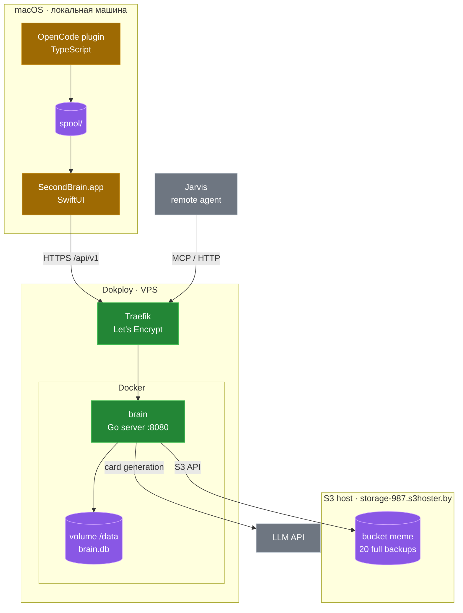

## 10.1 Dokploy

- Application → Dockerfile.
- Один контейнер `brain`.
- Port `8080`.
- Domain `brain.example.com`.
- HTTPS/Let's Encrypt через Traefik.
- Persistent volume → `/data`.
- Одна реплика, stop-first при деплое (SQLite не любит двух писателей).
- Healthcheck `/health`.

## 10.2 Переменные сервера

```text
BRAIN_DB=/data/brain.db
BRAIN_ADDR=0.0.0.0:8080
BRAIN_ADMIN_TOKEN=...
BRAIN_LLM_BASE_URL=...
BRAIN_LLM_API_KEY=...
BRAIN_LLM_MODEL=...
BRAIN_LLM_MAX_INPUT_CHARS=24000

S3_ENDPOINT=https://storage-987.s3hoster.by
S3_REGION=BTC
S3_BUCKET=meme
S3_ACCESS_KEY=...
S3_SECRET_KEY=...
S3_USE_SSL=true

BACKUP_CRON=0 */6 * * *
BACKUP_KEEP=20
```

## 10.3 Локальная машина

```text
~/.config/second-brain/
├── config.json          # URL сервера, настройки
├── mcp_token            # 0600, для OpenCode MCP
└── spool/               # JSON-бандлы
```

Токены приложения — в Keychain. Токен для OpenCode — файл `0600`, потому что OpenCode не умеет читать Keychain.

## 10.4 Сборка

| Компонент | Как собирается |
|---|---|
| `brain` | Docker multi-stage, Go, distroless/static |
| `SecondBrain.app` | Xcode / `xcodebuild` на macOS |
| OpenCode plugin | TypeScript, без сборки, кладётся приложением |

Docker не может собрать macOS-приложение: SwiftUI требует Apple SDK. Для CI нужен macOS-runner (например, GitHub Actions `macos-latest`), не Linux-контейнер.

---

# 11. Бэкапы и восстановление

## 11.1 Параметры

```text
Endpoint: https://storage-987.s3hoster.by
Region:   BTC
Bucket:   meme
Prefix:   отсутствует
Schedule: каждые 6 часов
Keep:     20
Crypto:   нет, только TLS
```

20 копий × 6 часов = 5 дней истории.

## 11.2 Pipeline

```text
1. PRAGMA wal_checkpoint(TRUNCATE)
2. VACUUM INTO /data/tmp/brain-<timestamp>.db
3. PRAGMA integrity_check
4. zstd
5. PutObject → meme/brain-<timestamp>.db.zst
6. ListObjects(bucket="meme")
7. filter .db.zst
8. sort by key descending
9. delete objects[20:]
10. remove local temp
```

Правила:

- ротация только после успешной загрузки;
- `ListObjects` упал → ничего не удаляем;
- удаление не удалось → логируем, следующая ротация добьёт;
- удаляем только `.db.zst`;
- версионирование предполагается выключенным;
- SHA-256 хранится в metadata объекта.

## 11.3 CLI

```bash
brain backup run
brain backup list
brain restore --object brain-2026-11-03T06-00-00Z.db.zst --db /data/brain.db
```

Восстановление:

1. Остановить `brain` в Dokploy.
2. Запустить one-off контейнер с volume.
3. `brain restore`.
4. Запустить `brain` обратно.

Перед заменой текущая база сохраняется как `brain.db.pre-restore`.

## 11.4 Чего нет

- таблицы `backup_runs`;
- backup API;
- backup UI;
- шифрования;
- Litestream/инкрементов;
- уведомлений в приложении.

Только логи сервера и CLI.

---

# 12. Безопасность

- TLS на всех внешних соединениях (Traefik + Let's Encrypt).
- Bearer-токены, хешированные в БД.
- Скоупы: `ingest`, `mcp:read`, `mcp:write`, `ui`, `admin`.
- `source` определяется по токену, не по телу запроса.
- S3-бакет приватный, отдельный access key с минимальными правами.
- Не использовать `"Principal": "*"` в bucket policy.
- Токены OpenCode — файлы `0600`; токены приложения — Keychain.
- Секреты маскируются до LLM и до записи в БД.
- MCP `remember` требует `mcp:write`.
- Лимит размера payload (например, 10 МБ).
- Rate limit на ingest и MCP.
- Прямого доступа к SQLite по сети нет.
- Бэкапы не шифруются (решение пользователя), но бакет приватный и TLS обязателен.
- Промпт карточки обрабатывает текст сессии как данные, а не как инструкции.

---

# 13. Наблюдаемость и эксплуатация

- `/health` — процесс, БД, версия схемы.
- Структурированные логи (`slog`) в stdout, Dokploy собирает.
- `GET /api/v1/stats` — записи, проекты, клиенты, очередь.
- `GET /api/v1/jobs` — состояние очереди для UI.
- Ошибки ingestion и card generation видны в dashboard.
- Ошибки бэкапов — только в логах сервера (по требованию).
- Healthcheck контейнера в Dokploy.
- Одна реплика, stop-first при деплое.
- Volume `brain-data` — единственное место с `brain.db`.

---

# 14. Architecture Decision Records

| ID | Решение | Причина |
|---|---|---|
| ADR-1 | Центральная БД на сервере | Доступ с разных машин и агентов, единая память |
| ADR-2 | Никто не пишет в SQLite напрямую | Один writer, целостность, валидация, маскировка |
| ADR-3 | OpenCode plugin + spool | Плагин — тонкий адаптер, приложение владеет отправкой |
| ADR-4 | Поиск и карточки на сервере | Локальное приложение остаётся простым |
| ADR-5 | MCP streamable HTTP + bearer | OpenCode и Jarvis подключаются удалённо |
| ADR-6 | Полные бэкапы в S3 каждые 6 часов | Простота, предсказуемое восстановление |
| ADR-7 | Хранить 20 бэкапов | 5 дней истории |
| ADR-8 | Нет backup UI/API | Восстановление — редкая ручная операция |
| ADR-9 | SwiftUI `.app` | Единственный локальный executable, нативный UI |
| ADR-10 | Сервер в Dokploy | TLS, деплой, volume, логи |

---

# 15. Открытые вопросы

1. **Jarvis**: MCP-клиент или только HTTP? Поддерживаем оба, но нужно подтвердить основной путь.
2. **Backfill**: вся история OpenCode или последние N месяцев? Влияет на стоимость LLM.
3. **LLM**: провайдер, модель, месячный бюджет.
4. **Доступ**: только HTTPS + токены или дополнительно ограничить по IP/Tailscale?
5. **OpenCode**: захватывать все проекты глобально или сделать opt-in/ignore-list?
6. **S3 versioning**: предполагаем выключенным. Если включён — нужен lifecycle на noncurrent versions.

---

# 16. Что не входит в v1

- Claude Code и Codex.
- Другие агенты и коннекторы (GitHub, Notion, почта).
- Векторный поиск и эмбеддинги.
- Локальный поиск в приложении.
- Web-UI на сервере.
- Litestream и непрерывная репликация.
- Шифрование бэкапов.
- Backup UI/API.
- Мобильные клиенты.
